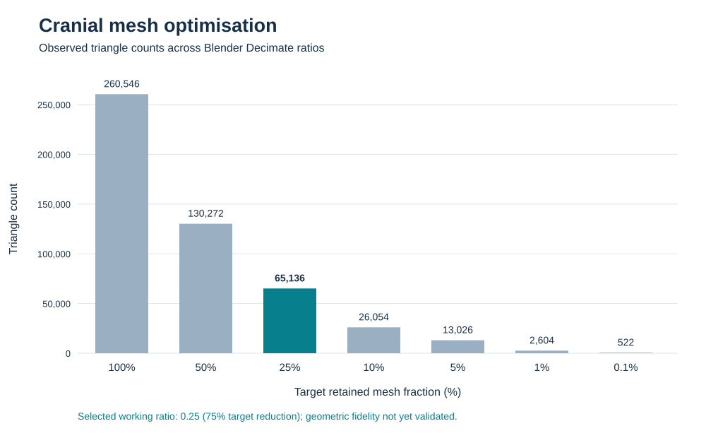

# Mesh optimisation — 27 November 2026

Blender 5.3.0; metric units, scale 0.001, millimetres. Original reference saved separately as Skull_Original_v01.blend. Working file: Skull_Mesh_Optimisation_v01.blend. Collapse Decimate modifier tested without applying it.

| Ratio | Observed triangles |
|---:|---:|
| 1 | 260546 |
| 0.5 | 130272 |
| 0.25 | 65136 |
| 0.1 | 26054 |
| 0.05 | 13026 |
| 0.01 | 2604 |
| 0.001 | 522 |

The 0.25 ratio was provisionally selected: 65,136 triangles versus 260,546 originally, approximately 75% reduction. Displayed bounding dimensions remain 147 × 197 × 162 mm. Visual inspection suggests retention of gross contour and defect boundary, whereas lower ratios show increasing faceting. At 0.05 the displayed Y dimension changes to 196 mm. At 0.001 severe shape loss is visible. Counts are screenshot observations, not predicted counts; the 0.001 result is 522 triangles. Bounding dimensions and visual appearance alone do not establish local accuracy. Quantitative surface deviation, especially at the defect rim, must be checked against the original before final implant fit assessment. The surface-deviation CSV values have not been verified here.

Front orthographic inspection shows apparent anatomical misalignment and an offset origin; establish a patient-specific symmetry plane before mirroring. This is an educational design exercise, not a clinically validated implant.
